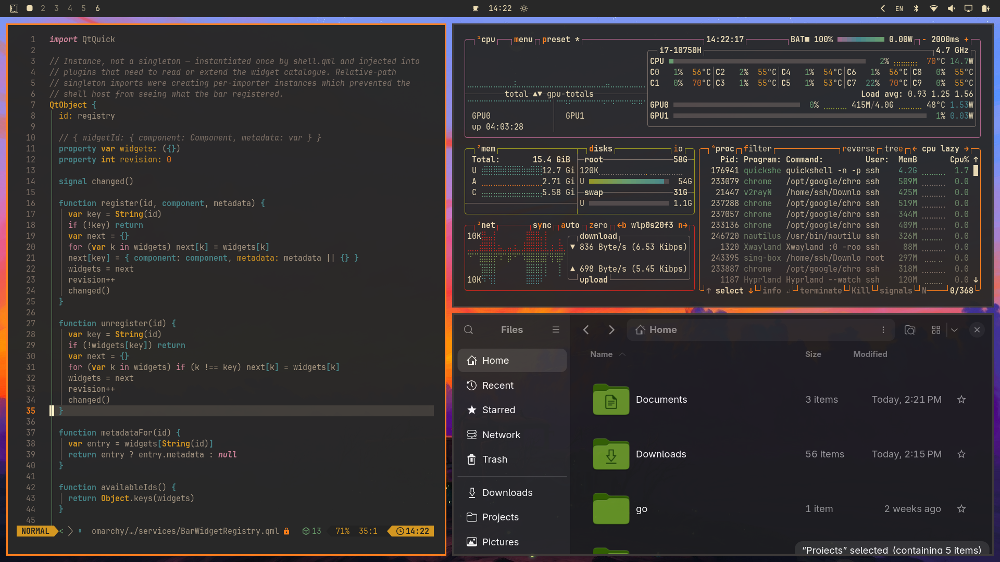

# Retro Bloom

A warm, retro Gruvbox-inspired dark theme for [Omarchy](https://omarchy.org), built around a soft charcoal background and a glowing orange accent.



## Install

```
omarchy theme install https://github.com/<your-username>/omarchy-retro-bloom-theme
```

## About

Retro Bloom pairs a classic Gruvbox dark palette with warm orange highlights — active borders, cursor, and accents all bloom against the muted background for a cozy, focused desktop.

[omarchy.org](https://omarchy.org)
